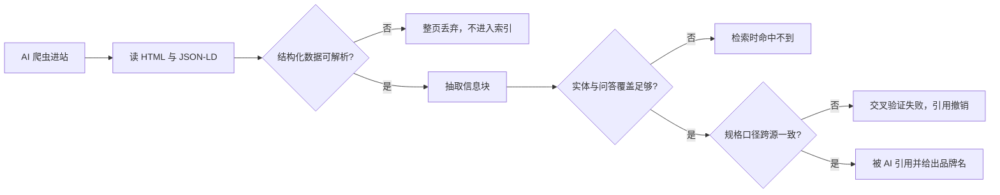
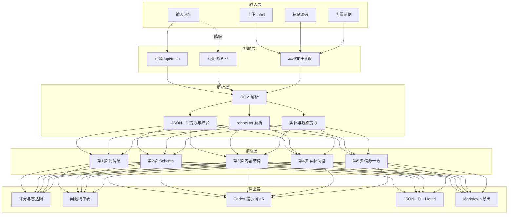

# CAIS · AI 搜索适配诊断工具

客户输入网址，工具扫描全站代码层，输出 GEO 问题清单、Codex 提示词与 Schema 修复代码。同时做 MTO 机器信任诊断：探测 MCP 端点、A2A Agent Card 与接口文档，判断 Agent 能否与网站后台通信。MTO 部分只给诊断与建议，不给修复代码。

单文件、零构建、零外部依赖。部署到任意静态托管即可交付客户自助使用。

---

## 目录

- [一、它解决什么问题](#一它解决什么问题)
- [二、快速开始](#二快速开始)
- [三、文件结构](#三文件结构)
- [四、诊断内容：GEO 五步 39 项 + MTO 四层](#四诊断内容geo-五步-39-项--mto-四层)
- [五、评分体系](#五评分体系)
- [六、用户手册](#六用户手册)
- [七、报告读法与修复流程](#七报告读法与修复流程)
- [八、链接参数](#八链接参数)
- [九、部署](#九部署)
- [十、技术设计](#十技术设计)
- [十一、边界与限制](#十一边界与限制)
- [十二、常见问题](#十二常见问题)

---

## 一、它解决什么问题

AI 爬虫进站第一件事不是读内容，是读 HTML。Schema 未渲染、JSON-LD 报错，内容再好也抽不走。

传统 SEO 工具查排名、查外链。CAIS 只查一件事：**AI 能否从你的页面里抽出可引用的信息块**。

诊断链路：



CAIS 检测 C、F、H 三个判断点上的全部失败原因。

---

## 二、快速开始

三条路线，按你的托管条件选。

| 路线 | 条件 | 客户能否直接输网址 | 操作 |
|---|---|---|---|
| D · Node 服务 | 有一台能跑 Node 的机器或容器 | 能，开箱即用 | `node caiserver.js` |
| A1 · Cloudflare Pages | 有 Cloudflare 账号 | 能，开箱即用 | `npm run deploy` |
| B · 任意静态托管 + 独立代理 | 有静态空间，能部署一个 Worker | 能，需用链接预置代理 | 上传 `cais.html` + 部署 `caiworker/caistandalone-worker.js` |
| C · 纯静态 | 只有一个静态空间 | 不能，改用上传或粘贴 | 只上传 `cais.html` |

**路线 D · Node 服务（最快验证抓取能力）**

```bash
node caiserver.js
# 打开 http://localhost:3000
```

单端口同时提供静态页与同源抓取代理。无第三方依赖，Node 18+ 直接跑。端口用 `PORT` 环境变量覆盖。

适合：本地演示、自有服务器、容器部署、任意支持 Node 的 PaaS。

**路线 A · Cloudflare Pages（推荐）**

```bash
cd ai-search-audit
npm run deploy
```

首次运行会拉起浏览器授权 Cloudflare 账号。无图形界面时用 API 令牌：

```bash
CLOUDFLARE_API_TOKEN=你的令牌 npm run deploy
```

完成后返回 `https://xxx.pages.dev/cais`，直接发给客户。

**路线 B · 静态托管 + 独立代理**

1. 上传 `cais.html` 到任意静态空间
2. 把 `caiworker/caistandalone-worker.js` 部署到 Cloudflare Workers，得到地址 `https://cais-proxy.xxx.workers.dev`
3. 用链接把代理地址预置进去，把这个链接发给客户：

```
https://你的域名/cais.html?proxy=https://cais-proxy.xxx.workers.dev/?url=
```

客户打开即可直接输网址扫描，无需任何配置。

**路线 C · 纯静态**

只上传 `cais.html`。客户使用「上传网页文件」或「粘贴源码」模式。诊断功能完整，只缺网址自动抓取。

**本地预览**

```bash
npm run dev
# 打开 http://localhost:8788/cais.html
```

---

## 三、文件结构

```
cai-project/
├── cais.html                                 诊断页本体。单文件，1361 行，零依赖
├── caiserver.js                              Node 单端口服务。静态托管 + /api/fetch 代理
├── caifunctions/api/fetch.js                 Cloudflare Pages 同源抓取代理，路由 /api/fetch
├── caiworker/caistandalone-worker.js         独立 Cloudflare Worker，给不支持 Functions 的托管用
├── caipackage.json                           命令入口：start / dev / deploy
└── caiREADME.md                              本文件
```

| 文件 | 必需性 | 说明 |
|---|---|---|
| `cais.html` | 必需 | 全部诊断逻辑在此。CSS 与 JS 内联，可单独双击打开 |
| `caiserver.js` | 路线 A2 / D 需要 | Node 18+ 原生 http，无第三方依赖。同时提供静态页与抓取代理 |
| `caifunctions/api/fetch.js` | 路线 A1 需要 | Cloudflare Pages 版代理，与静态页同域 |
| `caiworker/caistandalone-worker.js` | 路线 B 需要 | 独立 Worker 版代理，入口格式不同 |
| `caipackage.json` | 部署用 | 不含运行时依赖，`npm install` 只拉 wrangler |
| `package.json` | 部署用 | 不含运行时依赖，`npm install` 只拉 wrangler |

---

## 四、诊断内容：GEO 五步 39 项 + MTO 四层

### 第 1 步 · 代码层漏洞（15 项）

AI 爬虫进站先读 HTML。这一步查代码层能否被解析。

| 检测项 | 严重度 | 判定依据 |
|---|---|---|
| robots.txt 屏蔽 AI 爬虫 | 致命 | 12 个 UA 逐一比对 Disallow 规则 |
| JSON-LD 语法错误 | 致命 | 解析失败。区分尾部逗号与单引号 |
| 页面设置 `noindex` | 致命 | meta robots 含 noindex |
| `nosnippet` / `max-snippet:0` | 致命 | meta robots 禁用片段，AI 无法引用 |
| Product 必填字段缺失 | 致命 | name、image、description、sku、brand、offers |
| `gtin` / `mpn` 缺失 | 致命 | 产品无法与全球目录对齐 |
| FAQPage Schema 结构非法 | 致命 | `acceptedAnswer.text` 为空或缺失 |
| metafield 有值但模板未渲染 | 致命 | 空 `data-metafield` 元素、空值字段 |
| 整页无任何 JSON-LD | 致命 | — |
| JSON-LD 脚本块为空 | 严重 | — |
| Offer 字段不完整 | 严重 | price、priceCurrency、availability 等 7 项 |
| Schema 字段存在但值为空 | 严重 | — |
| FAQ 页没有 FAQPage Schema | 严重 | — |
| 残留未渲染的 Liquid 变量 | 中等 | `{{ ... }}` 出现在 HTML 输出中 |
| meta description 缺失 | 中等 | — |
| 缺少 canonical | 中等 | — |

### 第 2 步 · Schema 完整度（7 层）

七层 Schema 按权重计分，缺失即扣分。

| 层 | 权重 | 作用 |
|---|---|---|
| Product | 5 | 产品主体。购物类引用入口 |
| FAQPage | 4 | 问答块。AI Overviews 抽取首选 |
| Organization | 3 | 品牌实体。AI 判断你是谁 |
| Offer | 3 | 价格与库存。ChatGPT 购物助手直接读取 |
| Review / AggregateRating | 3 | 评分与评价 |
| WebSite | 2 | 站点实体与站内搜索 |
| BreadcrumbList | 2 | 层级归属 |

### 第 3 步 · 内容结构（7 项）

AI 抽信息块，不读品牌故事。

| 检测项 | 严重度 |
|---|---|
| 答案密度低，正文是品牌故事不是信息块 | 致命 |
| 缺少 H2 分段，正文是一整块 | 严重 |
| 文本占比过低 | 严重 |
| 缺少列表或表格，参数不可机器比对 | 中等 |
| 缺语义标签（main / article） | 中等 |
| 多个 H1 或无 H1 | 中等 |
| 图片缺 alt | 中等 |

### 第 4 步 · 实体与问答页（4 项）

GEO 拼的是实体覆盖。每个问答页是一个 RAG 检索节点。

| 检测项 | 严重度 |
|---|---|
| 没有独立问答页 | 致命 |
| 实体覆盖稀薄 | 严重 |
| 内链稀疏，实体之间无关联 | 中等 |
| 站点根目录缺少 `llms.txt` | 轻微 |

### 第 5 步 · 信源一致性（6 项）

| 检测项 | 严重度 |
|---|---|
| 同一页面内规格数值自相矛盾 | 致命 |
| 认证编号未在页面输出 | 严重 |
| 跨平台口径待核对（Amazon / 目录站 / 社媒） | 严重 |
| 跨页规格数值存在差异，需确认是否同一参数 | 中等 |
| 多语言站缺 `hreflang` | 中等 |
| robots.txt 未声明 sitemap | 中等 |

**冲突判定分两级，避免误伤：**

- 页内同一单位出现多个数值 → 致命。确凿错误，AI 交叉验证时会判定不可信
- 跨页差异 → 中等。可能只是不同产品，标注为待人工确认

### MTO 四层（独立评分，只诊断不给修复）

MTO（Machine Trust Optimization，机器信任优化）解决「被机器信任」，与 GEO 构成递进双层：

| | GEO | MTO |
|---|---|---|
| 解决的问题 | 被 AI 看见 | 被机器信任 |
| 终点 | AI 愿意推荐你（入场资格） | 机器敢直接买你（自主交易） |
| 成熟度 | 可用 | 理论推演阶段 |

标准参考 [duckwolf.cn/mto.html](https://duckwolf.cn/mto.html)。四层检测内容：

**L1 · 证据链层（25 分）**

| 检测项 | 判定依据 |
|---|---|
| 认证编号是否输出 | 匹配 ATEX / CE / UL / ISO / IECEx / IP 等级等 16 类 |
| 认证是否带签发方与有效期 | 匹配「签发机构 / 证书编号 / 有效期至 / valid until」 |
| 是否引用可核验标准依据 | 匹配 GB / ISO / IEC / EN / ASTM / JIS / DIN 标准号 |
| 是否有溯源外链 | 匹配 TUV / SGS / Intertek / UL 等发证机构 |

**L2 · 机器可读层（25 分）**

| 检测项 | 判定依据 |
|---|---|
| llms.txt | 根目录探测 |
| llms-full.txt | 根目录探测 |
| ai.txt | 根目录与 `.well-known` 探测 |
| 关键事实是否只由图片承载 | 无 alt 图片占比 |
| 字段口径标准化 | 复用 GEO 的规格冲突判定 |

**L3 · 信任量化层（15 分，实验性）**

| 检测项 | 判定依据 |
|---|---|
| 一致性 | 页内冲突与跨页差异数量 |
| 数据时效性声明 | dateModified / lastUpdated / 更新于 |
| 审计留痕 | security.txt 探测 + 审计表述匹配 |

**L4 · 协议与执行层（35 分）**

| 检测项 | 探测路径 |
|---|---|
| A2A Agent Card | `/.well-known/agent.json`、`/.well-known/agent-card.json` |
| MCP 端点 | `/.well-known/mcp.json`、`/mcp`、`/mcp/sse`、`/sse`、`/api/mcp` |
| 接口文档 | `/openapi.json`、`/api/openapi.json`、`/swagger.json`、`/v3/api-docs` |
| AI 插件清单 | `/.well-known/ai-plugin.json` |
| Agent Card 字段完整度 | name、description、url、version、capabilities、skills、authentication 等 9 项 |

**状态码判定**：200 视为可用；401/403 视为存在但需授权（Agent Card 加鉴权会让它失去作用，会单独告警）；404 视为未部署；无响应视为未探测到。

**页面静态声明**：若页面出现 MCP / A2A / OpenAPI 字样但端点探测不到，会判定为「声明了但未部署」，并单独给出提示。

**MTO 部分只输出诊断与建议，不生成任何修复代码、提示词或模板。**

---

## 五、评分体系

总分 100，按五步分配。

| 步骤 | 满分 | 考察对象 |
|---|---|---|
| 1 · 代码层漏洞 | 32 | Schema 可解析性、必填字段、爬虫可达性 |
| 2 · Schema 完整度 | 22 | 七层覆盖度，按权重计分 |
| 3 · 内容结构 | 18 | 答案密度、分段、语义标签 |
| 4 · 实体与问答页 | 16 | 实体数量、问答页覆盖、内链 |
| 5 · 信源一致性 | 12 | 规格冲突、认证输出、跨平台口径 |

扣分项按页面数归一化。站点页面越多，单页问题对总分的影响越小。

| 总分 | 等级 | 含义 |
|---|---|---|
| 80–100 | AI 就绪 | 结构完整，可被稳定引用 |
| 60–79 | 基本可用，需补关键项 | 主要结构在，缺关键字段或问答页 |
| 40–59 | 有引用风险 | 结构性缺陷已影响抽取 |
| 20–39 | AI 基本抽不走 | 代码层有致命问题 |
| 0–19 | AI 不可见 | 爬虫被屏蔽或 Schema 全面失效 |

严重度分四级：致命、严重、中等、轻微。报告按严重度排序，致命项优先处理。

### MTO 评分（独立 100 分）

| 层 | 满分 | 考察对象 |
|---|---|---|
| L1 · 证据链层 | 25 | 认证编号、签发方与有效期、标准依据、溯源链接 |
| L2 · 机器可读层 | 25 | llms.txt 系列、图片 alt、字段口径 |
| L3 · 信任量化层 | 15 | 一致性、时效性、审计留痕。实验性 |
| L4 · 协议与执行层 | 35 | MCP 端点、A2A Agent Card、接口文档 |

| 总分 | 等级 | 含义 |
|---|---|---|
| 75–100 | 机器可核验 | 四层齐备，外部 Agent 可自主核验 |
| 50–74 | 部分可核验 | 有接口或证据，但有缺层 |
| 25–49 | 机器难以核验 | 缺关键层，无法完成验证闭环 |
| 0–24 | 机器不可见 | 无接口、无证据链 |

GEO 与 MTO 分别计分，互不折算。两个分数在报告顶部并列显示。

---

## 六、用户手册

### 模式一：输入网址抓取（默认）

1. 打开页面
2. 在输入框填目标域名，例如 `https://example.com`
3. 选扫描深度：仅首页 / 6 页 / 12 页 / 20 页
4. 点「开始诊断」
5. 等待进度日志跑完，报告自动生成

工具会自动读取 `robots.txt`、解析站内链接、按深度抓取、逐页诊断、汇总全站问题。

页面顶部会显示通道状态：

- 绿色「同源抓取通道已就绪」→ 部署在 Cloudflare Pages 上，可直抓全站
- 无提示 → 走公共代理，成功率不稳定

**抓取失败时**：切到模式二。成功率更高。

### 模式二：上传网页文件（最稳）

适合整站诊断。

1. 用整站下载工具导出目标站：
   - HTTrack：`httrack https://example.com -O ./site`
   - wget：`wget -r -l 2 -k https://example.com`
   - Screaming Frog：爬取后导出 HTML
2. 切到「上传网页文件」模式
3. 拖入或选择全部 `.html` 文件，支持多选
4. 如有 `robots.txt`，一并上传，命名为 `robots.txt`
5. 点「生成诊断报告」

**命名建议**：文件名会被当作 URL。按路径命名，例如 `products_industrial-pump.html`。路径信息会影响问答页识别与内链统计。

### 模式三：粘贴源码（兜底）

适合单页快速验证。

1. 打开目标页面 → 右键 → 查看网页源代码 → 全选复制
2. 切到「粘贴源码」模式
3. 填页面 URL，粘贴源码，点「添加这一页」
4. 重复以上步骤可添加多页
5. 可选：粘贴 `robots.txt` 内容，用于检测 AI 爬虫屏蔽
6. 点「生成诊断报告」

### 模式四：示例站点

内置三个示例，用于演示诊断逻辑与报告形态。不代表任何真实站点。

| 示例 | 构造的缺陷 |
|---|---|
| 工业泵站 | gtin 大面积空缺 · FAQ JSON-LD 语法错误 |
| 储能站 | 认证编号后台有值 · 前端未输出 |
| 智能门锁站 | 续航口径不一致 · 无独立问答页 |

销售演示流程：先跑一遍示例站让客户看懂报告，再让客户输自己的网址。

---

## 七、报告读法与修复流程

报告分六块：总分与等级、五步分项、问题清单、逐页明细、Codex 提示词、Schema 修复代码。

### 第一步：看总分与五步分项

雷达图显示五步各自的得分率。找最短的那根轴，从那里开始修。

### 第二步：看问题清单

每行五项：严重度、步骤、问题、影响、证据、修复动作。

按严重度从上往下处理。致命项全部处理完，再处理严重项。

### 第三步：复制 Codex 提示词

报告按步骤生成 5 条提示词，已预填你的域名。逐步独立复制，粘进 Codex 执行。

| 步骤 | 提示词作用 |
|---|---|
| 1 | 以 Google AI Overviews 与 ChatGPT 购物助手双视角扫描代码层，输出问题清单与 Liquid 修改建议 |
| 2 | 生成七层 Schema 的 JSON-LD，用 Liquid 变量动态调用产品数据 |
| 3 | 批量改写内容结构，把品牌故事改成信息块 |
| 4 | 铺实体与独立问答页选题 |
| 5 | 跨平台信源核对清单与验证话术 |

### 第四步：套用 Schema 修复代码

报告给出两个版本，按你的站点类型选：

- **静态 JSON-LD**：直接粘贴，适合 WordPress、静态站
- **Shopify Liquid**：用变量动态调用产品数据，一次改完全站

两个版本都可一键复制或下载。

### 第五步：人工核对跨平台口径

第 5 步只输出核对清单与验证话术。工具不生成任何未经核实的第三方结论。

逐渠道核对同一参数：官网、Amazon、目录站、社媒。发现不一致就统一口径，再提交更新。

### 导出

点「下载 Markdown 报告」，得到完整的 `.md` 文件。含总分、问题清单、逐页明细、五步提示词、Liquid 模板。可直接发给客户或存档。

---

## 八、链接参数

三个参数可组合，用于把预配置好的链接直接发给客户。

| 参数 | 作用 |
|---|---|
| `?url=域名` | 预填待扫描网址 |
| `?proxy=代理地址` | 预置抓取代理地址 |
| `?autorun=1` | 打开即自动开始扫描 |

**示例**：预填网址、预置代理、打开即自动跑

```
https://你的域名/cais.html?url=example.com&proxy=https://cais-proxy.xxx.workers.dev/?url=&autorun=1
```

**用法**：批量发给客户时，为每个客户生成一条带 `?url=` 的链接。客户点开只需点一次「开始诊断」。

---

## 九、部署

### 9.1 Cloudflare Pages · Git 连接

适合不碰命令行。

1. 把本目录推到 GitHub 仓库
2. Cloudflare Dashboard → Workers & Pages → Create → Pages → Connect to Git
3. 构建配置：
   - Framework preset：**None**
   - Build command：**留空**
   - Build output directory：**`.`**
4. Save and Deploy

之后每次 `git push` 自动重新发布。

**注意**：`caifunctions/` 目录必须留在仓库根目录，Pages 才会把它识别为 `/api/fetch` 路由。部署时需在仓库根目录创建软链接：`mklink /D functions caifunctions`（Windows）或 `ln -s caifunctions functions`（Linux/Mac）。

### 9.2 Cloudflare Pages · 命令行

```bash
npm run deploy
```

### 9.3 GitHub Pages

1. 仓库 Settings → Pages → Source 选 `Deploy from a branch`，分支选 `main`，目录选 `/ (root)`
2. 访问路径：`https://用户名.github.io/仓库名/cais.html`
3. GitHub Pages 不执行 `functions/`，网址抓取会降级到公共代理
4. 需要网址抓取能力时，按路线 B 部署独立 Worker，用 `?proxy=` 预置地址

### 9.4 访问路径

| 托管平台 | 路径 |
|---|---|
| Node 服务（`server.js`） | 根路径 `/` 直接打开，`/cais` 与 `/cais.html` 也可 |
| Cloudflare Pages | `/cais`。访问 `/cais.html` 会 308 跳转到 `/cais`，浏览器自动跟随 |
| GitHub Pages / 腾讯云 COS / 虚拟主机 | `/cais.html` |

需要用根路径 `/` 直接打开时，把 `cais.html` 改名为 `index.html`，或在托管平台把它设为索引文档。

### 9.5 额度

| 项 | 免费额度 |
|---|---|
| Pages 静态带宽 | 无限，可商用，免备案 |
| Pages Functions | 每天 10 万次请求 |
| 单次深度扫描（20 页） | 约消耗 21 次请求 |
| 每日可扫描次数 | 约 4700 次 |

超出后 Functions 停服直到次日重置，静态页不受影响。

---

## 十、技术设计

### 10.1 架构



### 10.2 抓取通道降级链

浏览器不能直接跨域读取其他网站。工具按顺序尝试 7 个通道，第一个成功的即采用：

| 顺序 | 通道 | 说明 |
|---|---|---|
| 1 | 同源 `/api/fetch` | 部署在 Cloudflare Pages 或 Node 服务上时优先命中 |
| 2 | allorigins | 公共代理 |
| 3 | codetabs | 公共代理 |
| 4 | corsproxy.io | 公共代理 |
| 5 | r.jina.ai | 公共代理，返回 Markdown 化内容 |
| 6 | thingproxy | 公共代理 |
| 7 | cors.workers.dev | 公共代理 |

全部失败时，提示改用「上传网页文件」模式。

### 10.3 代理安全防护

三份代理实现（`server.js`、`functions/api/fetch.js`、`worker/standalone-worker.js`）内置同一套防护：

| 防护 | 作用 |
|---|---|
| 协议白名单 | 只允许 http / https，拦截 `file://` 等 |
| 内网与云元数据地址拦截 | 防 SSRF。拦截私有网段与 `169.254.169.254` |
| DNS 解析后二次校验 | `server.js` 专属。解析目标域名全部 A/AAAA 记录，任一命中私有段即拦截 |
| 重定向逐跳校验 | `server.js` 专属。手动跟随跳转，最多 5 跳，每跳重新校验，防止跳进内网 |
| 体积上限 3MB | 防止超大响应拖垮请求 |
| 同源 Referer 校验 | 带 Referer 时校验来源，防盗用 |

响应头 `no-store`，不缓存。诊断读的始终是实时页面。

### 10.4 解析实现

全部在浏览器内完成，不发数据到任何第三方分析服务。

- DOM 解析：`DOMParser` + 原生 querySelector
- JSON-LD 提取：遍历 `script[type="application/ld+json"]`，逐个 `JSON.parse`，捕获语法错误并定位
- 嵌套展开：`@graph`、`mainEntity`、`itemListElement`、`hasVariant`、`acceptedAnswer` 逐层展平
- 实体提取：中文按 2–4 字窗口切分，过滤停用词表，按词频排序
- 规格提取：正则匹配「数值 + 单位」，支持 23 种单位（个月、kW、MPa、cycles 等）
- 认证识别：正则匹配 ATEX、CE、UL、IECEx、ISO、IP 等级等 16 类认证编号

---

## 十一、边界与限制

工具只做静态源码解析。以下情况不在检测范围内：

| 限制 | 说明 |
|---|---|
| JavaScript 渲染的内容 | 抓取的是原始 HTML。SPA 站点请改用「粘贴源码」模式，粘贴渲染后的源码 |
| 需要登录的页面 | 无法抓取 |
| 跨平台真实数据 | 第 5 步只输出核对清单。工具不访问 Amazon、目录站、社媒，不生成未经核实的结论 |
| AI 引用状态的实时验证 | 引用状态需人工在 ChatGPT / Gemini 中提问验证。工具输出验证话术，不代跑 |
| robots.txt 抓取失败 | 跳过第 1 步爬虫可达性检测，不影响其余四步 |
| 抓取频率 | 无内置限速。大站请用上传模式，避免触发目标站反爬 |

---

## 十二、常见问题

**问：客户打开后输网址没反应？**

答：先看页面顶部的通道状态。没有绿色提示说明同源代理不可用，正在走公共代理。公共代理成功率不稳定。解决方法：按路线 B 部署独立 Worker，用 `?proxy=` 预置地址。或改用「上传网页文件」模式。

**问：本地双击打开能用吗？**

答：能。但 `file://` 协议下同源通道不可用。用「上传网页文件」或「示例站点」模式。

**问：能诊断多少个页面？**

答：网址模式最多 20 页。上传模式不限，一次可选全部 `.html`。

**问：示例站点的数据是真的吗？**

答：不是。示例数据是构造的，用于演示诊断逻辑与报告形态。

**问：诊断会向第三方泄露客户网址吗？**

答：部署在 Cloudflare Pages 上时，请求只经过你自己的 Functions，不经过任何第三方。走公共代理时，目标网址会暴露给该代理服务商。对隐私敏感的客户，请用上传模式。

**问：抓取返回 403，内容是「WAF 拦截页面」？**

答：不是工具的问题，是托管平台的 WAF 拦了这个请求。`example.com` 这类常被用作 SSRF 测试payload 的域名，容易被规则库命中。换个目标域名即正常。若你的客户域名被误拦，把 `?proxy=` 指向自建 Worker，或用「上传网页文件」模式。

**问：MTO 部分为什么不生成修复代码？**

答：MTO 目前处于理论推演阶段，L3 信任量化层的指标未经真实交易场景验证。给未经验证的框架生成"修复代码"会造成误导。MTO 部分因此只输出诊断结论与方向性建议。GEO 五步的修复代码照常输出。

**问：端点探测会扫到别人的服务器吗？**

答：只探测你输入的那个域名根路径下的 16 个约定路径。全部是公开的协议约定位置（`.well-known` 等），不含路径爆破或漏洞扫描。探测只走同源代理，不经过第三方。

**问：怎么改成英文界面？**

答：所有文案在 `cais.html` 内。搜索中文字符串直接替换即可，无需改逻辑。

**问：能接自己的 AI 模型自动生成修复方案吗？**

答：当前不接。工具的设计定位是「诊断 + 生成提示词」，修复动作交给 Codex 执行。这样客户可以看到每一步的依据。

---

## 更新记录

| 版本 | 内容 |
|---|---|
| v1.0 | 五步诊断引擎、39 项检测、七层 Schema、Codex 提示词、Markdown 导出 |
| v1.1 | 新增 `nosnippet`、`noindex`、`llms.txt` 检测。公共代理增至 7 个。抓取通道状态改为静默探测 |
| v1.2 | 新增 `caiserver.js`：Node 单端口服务，静态托管与抓取代理同源。DNS 二次校验与逐跳重定向校验 |
| v1.3 | 新增 MTO 机器信任诊断：四层评分、16 个约定端点探测、Agent Card 字段校验。只输出诊断与建议 |
| v1.4 | 参照 GEOInflow v1.2 目录扩充 AI 爬虫 UA 至 60+ 身份（含用途分类：训练/搜索/用户触发）。增强 robots.txt 检测按用途分类展示。增强 llms.txt 质量评估（不仅探测存在性，还评估结构、链接密度、描述完整性）。文件名加 `cai` 前缀避免托管冲突 |

## 许可

MIT。
